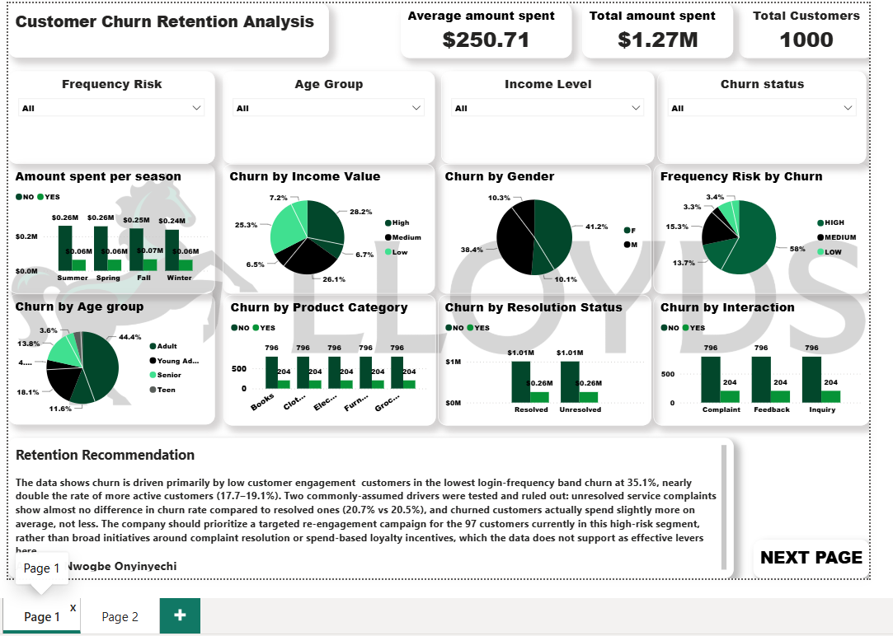
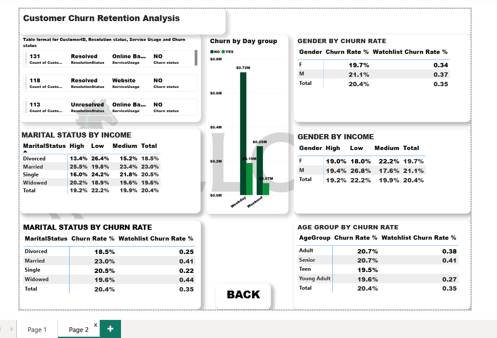

Customer Churn Analysis — Retail Banking
> Which customers are leaving, and why? An end-to-end analysis of 1,000 retail banking customers using **PostgreSQL, Python, Excel and Power BI**.
---
1. Introduction
Customer churn is expensive: keeping an existing customer costs far less than winning a new one, so a bank needs to know who is at risk before they leave.
This project analyses a retail banking dataset of 1,000 customers across four linked tables (demographics, online activity, customer service and transactions). It identifies which customer behaviour is genuinely linked to churn, tests whether the pattern is statistically real, and ends with a specific, actionable recommendation, presented in an interactive two-page Power BI dashboard.
---
2. Problem Statement
The bank wants to reduce customer attrition but currently applies retention efforts broadly, without knowing which customer segments actually drive churn. Undirected retention spend is inefficient and dilutes the offers that matter most to at-risk customers.
Questions this project answers:
What is the overall churn rate?
Which customer segment churns the most (demographics, engagement, service, spend)?
Is that difference real, or just random noise?
Which commonly assumed drivers can be ruled out?
Who should the bank contact first?
---
3. Data Sourcing
The dataset has four related tables, all linked by `CustomerID`:
Table	Rows	What it contains
`Customer_Demographics`	1,000	Age, age group, gender, marital status, income level, churn status
`Online_Activity`	1,000	Login frequency and a login-frequency risk band (LOW / MEDIUM / HIGH)
`Customer_Service`	1,002	Interaction type (complaint, feedback, inquiry) and resolution status
`Transaction_History`	5,054	Amount spent and product category (books, clothing, electronics, furniture, groceries)
Source: [add where the dataset came from, e.g. the training provider or platform]
Formats used: the four tables as CSV files, and as one Excel workbook (`Customer_Churn_Dataset.xlsx`, one sheet per table).
Target variable: `Churn status` (`YES` = customer left, `NO` = customer stayed).
---
4. Tools and What I Used Each For
Tool	What I used it for
PostgreSQL (pgAdmin)	Created the database schema with primary and foreign keys, imported the four tables, joined them on `CustomerID`, calculated churn rate by segment, and wrote the retention watchlist query
Python (pandas, SciPy)	Ran data integrity checks, re-ran every finding independently, and tested significance (chi-square and two-proportion z-test). Run as a script and as a Jupyter notebook
Excel	Formula-driven summaries (`COUNTIFS`, `SUMPRODUCT`, PivotTables) that reproduce the SQL and Python results so any stakeholder can audit them, and the exported watchlist
Power BI (DAX)	Built the interactive two-page dashboard, the churn and watchlist measures, and the slicers
---
5. Data Transformation and Cleaning
Before any analysis, I checked the data and prepared it for reliable joins and comparisons.
Validation checks (all passed):
Row counts match the expected size of each table (1,000 / 1,000 / 1,002 / 5,054).
No missing values and no duplicate rows in any table.
`CustomerID` is unique in `Customer_Demographics` and `Online_Activity`.
Every `CustomerID` in the transaction and service tables exists in the demographics table, so no records are orphaned by joins.
`Churn status` has only the values `YES` (204) and `NO` (796).
Transformations:
Loaded into PostgreSQL with a defined schema: a primary key on `CustomerID` and foreign keys linking the other three tables to it.
Standardised column names (for example `Churn status` → `ChurnStatus`) so SQL queries are consistent.
Normalised text values in `Frequency Risk` (trimmed whitespace and forced upper case) so that `LOW`, `Low` and `LOW ` always match. An integrity check runs first in the Python script. If it ever finds unexpected values, it warns you instead of silently returning zero rows.
Joined each table to `Customer_Demographics` on `CustomerID`, then compared churn rates across segments within each table.
Used conditional aggregation (`CASE WHEN`) and `NULLIF` to calculate rates safely, without dividing by zero.
---
6. Analytics and Measures
SQL (PostgreSQL)
Churn rate by login-frequency-risk band: `JOIN` + `GROUP BY` + `CASE WHEN`.
Retention watchlist: all customers in the LOW band, ordered by lowest login frequency.
Marital status × income cross-tab using conditional aggregation.
Ruled-out drivers: churn by service resolution status, and average spend for churned vs retained customers.
Python (pandas + SciPy)
Re-ran every finding independently and added significance testing:
Chi-square test of independence (frequency-risk band vs churn): χ² = 14.37, p = 0.00076
Two-proportion z-test (LOW band vs all other bands): z = 3.77, p = 0.000164
Power BI (DAX measures)
```DAX
Churn Rate % =
VAR ChurnedCount = CALCULATE(COUNTROWS(Customer_Demographics), Customer_Demographics[Churn status] = "YES")
VAR TotalCount   = COUNTROWS(Customer_Demographics)
RETURN DIVIDE(ChurnedCount, TotalCount)

Watchlist Count =
CALCULATE(COUNTROWS(Online_Activity), Online_Activity[Frequency Risk] = "LOW")

Watchlist Churn Rate % =
VAR WatchlistCustomers = CALCULATETABLE(Online_Activity, Online_Activity[Frequency Risk] = "LOW")
VAR ChurnedInWatchlist = CALCULATE(COUNTROWS(Customer_Demographics),
    Customer_Demographics[Churn status] = "YES", WatchlistCustomers)
RETURN DIVIDE(ChurnedInWatchlist, COUNTROWS(WatchlistCustomers))
```
Key results
Measure	Result
Overall churn rate	20.4% (204 of 1,000 customers)
LOW login-frequency band	35.1% churn (97 customers, 34 churned)
MEDIUM band	17.7%
HIGH band	19.1%
Married vs divorced customers	23.0% vs 18.5%
Low vs high income	22.2% vs 19.2%
Age groups	19.5%–20.7% (flat, so not a driver)
Resolved vs unresolved service cases	20.5% vs 20.7% (no real difference)
Average spend, churned vs retained	about $253 vs $250 per transaction (churned customers spend slightly more)
---
7. Dashboard and Visuals
The Power BI dashboard has two pages. Page 1 gives the overview and the recommendation; page 2 goes into detail by segment. Navigation buttons (NEXT PAGE / BACK) move between them.
Page 1: Overview and Recommendation

Headline cards: average amount spent ($250.71), total amount spent ($1.27M) and total customers (1,000).
Slicers: Frequency Risk, Age Group, Income Level and Churn status. Every visual on the page responds to them.
Churn breakdowns: amount spent per season (split by churn), and churn by income level, gender, frequency risk, age group, product category, resolution status and interaction type.
Retention Recommendation box: a plain-language summary of the finding. Low-engagement customers churn at 35.1%, service resolution and spend were ruled out, and the bank should target the 97 customers in the high-risk segment.
Page 2: Segment Detail

Customer table: each customer's resolution status, service usage and churn status.
Churn by day group: amount spent on weekdays vs weekends, split by churn.
Churn rate tables: by gender, marital status and age group, each shown next to the Watchlist Churn Rate % (the churn rate within the low-engagement band).
Cross-tabs: marital status by income level and gender by income level, showing where churn is highest (for example, married customers on high income: 25.5%).
---
8. Recommendation
Build a low-engagement watchlist. Flag the 97 customers (about 10%) in the LOW login-frequency band for proactive outreach before they churn, instead of waiting for a complaint.
Test a re-engagement nudge (app notification, personalised email or a relationship-manager call) on this segment, and track whether login frequency and churn improve over the next quarter.
De-prioritise service-resolution-based retention triggers as the main lever. The data does not support them as the driver.
Use marital status and income only as secondary targeting criteria once the core programme is running, since their effect is real but smaller.
Validate before scaling: run an A/B test with a holdout group, re-check the analysis next quarter, and confirm with the digital team how the frequency-risk bands are defined.
---
9. Conclusions
Disengagement, not dissatisfaction, predicts churn. Customers who log in least churn at nearly double the rate of everyone else (35.1% vs about 18%), and the result is statistically significant (p < 0.001).
Age, gender, spend and service outcomes are not meaningful drivers. Reporting what doesn't matter is as important as reporting what does, because it stops the bank spending on the wrong levers.
A targeted programme aimed at about 10% of customers is more efficient than a broad retention campaign.
Limitation: this analysis shows an association, not proof of cause. Only an A/B test of the re-engagement nudge can show whether increasing engagement actually reduces churn.
---

Prepared by Nwogbe Onyinyechi Victoria · Data Analyst
